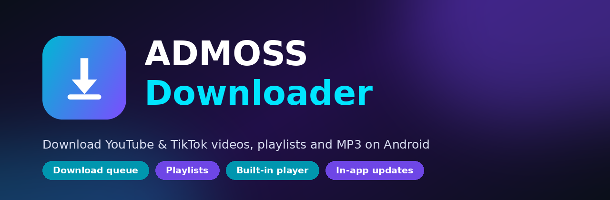

<div align="center">



<br>

[](https://github.com/ADMOSSx/ADMOSS-Downloader/releases/latest)
[](https://github.com/ADMOSSx/ADMOSS-Downloader/releases)
[](https://github.com/ADMOSSx/ADMOSS-Downloader/actions)


[](LICENSE)

### Download YouTube and TikTok videos, whole playlists and MP3 audio on Android.
### Queue, background downloads, a built-in player and in-app updates.

[**⬇️ Download the APK**](https://github.com/ADMOSSx/ADMOSS-Downloader/releases/latest) &nbsp;•&nbsp;
[**🐞 Report a bug**](https://github.com/ADMOSSx/ADMOSS-Downloader/issues/new/choose) &nbsp;•&nbsp;
[**💡 Request a feature**](https://github.com/ADMOSSx/ADMOSS-Downloader/issues/new/choose)

</div>

---

## Contents

- [Features](#-features)
- [Install](#-install)
- [How to use](#-how-to-use)
- [Screenshots](#-screenshots)
- [FAQ](#-faq)
- [Build it yourself](#-build-it-yourself)
- [Tech stack](#-tech-stack)
- [Project structure](#-project-structure)
- [Roadmap](#-roadmap)
- [Contributing](#-contributing)
- [Disclaimer](#-disclaimer)

---

## ✨ Features

| | Feature |
|---|---|
| 🎬 | Download from **YouTube**, **TikTok** and many other sites |
| 🔍 | See the **title, cover, duration and estimated size** before you download |
| 🎚️ | Choose the quality (Best, 1080p, 720p, 480p, 360p) with the size of each option |
| 🎵 | **MP3 audio** mode |
| 📚 | **Download queue**: paste many links, they download one after another |
| 📃 | **Playlist support**: load a whole playlist and pick the videos you want |
| 🧮 | **Playlist size calculator**: see the total download size of the selected videos, and the size of every video, before you download |
| 🗂️ | **Playlists section** in the Library: each playlist is a folder with all its videos in order |
| ▶️ | **Built-in player** with speed control (0.5x to 2x), double-tap to skip 10 seconds, **brightness and volume swipes**, **resume where you stopped**, repeat modes, zoom to fill and a **playlist menu** to jump to any video |
| 🔀 | **PLAY ALL** and **SHUFFLE** for playlists |
| 🖼️ | **Cover images** for every download and playlist |
| 🔔 | **Background downloads** with a notification (progress, cancel) |
| 🔎 | **Library** with search and storage stats (downloads, playlists, space used, size of each playlist) |
| 🌗 | **Dark and light** themes |
| 🔄 | **In-app updates**: new versions install over the old one |
| 🛡️ | Automatic **second try** with different network settings when YouTube blocks the first one |

---

## 📲 Install

1. Open the [**latest release**](https://github.com/ADMOSSx/ADMOSS-Downloader/releases/latest).
2. Download the APK for your phone:

| Your phone | File |
|---|---|
| Almost all phones | **`ADMOSS-Downloader-arm64-v8a.apk`** |
| Very old phones | `ADMOSS-Downloader-armeabi-v7a.apk` |

3. Open the file and allow **"Install unknown apps"** when Android asks.
4. Open the app, paste a link and tap **DOWNLOAD**.

**Requirements:** Android 10 or newer and an internet connection.

> **Updating:** since v1.4 every build is signed with the same key, so new versions install **over the old one** and the app can update itself. If you have a version older than 1.4, uninstall it one last time.

---

## 🧑‍💻 How to use

1. Copy a YouTube or TikTok link. You can also use **Share** inside those apps and pick ADMOSS Downloader.
2. Paste it in the app. The cover, title and size appear.
3. Choose **Video** or **Audio MP3** and a quality.
4. Tap **DOWNLOAD**. You can leave the app, it keeps working in the background.
5. Find your files in the **Library** tab. Playlists have their own section.

---

## 🖼️ Screenshots

<!--
Add your screenshots to docs/screenshots/ and remove the comment markers around the block below.

<div align="center">


</div>
-->

*Screenshots coming soon.*

---

## ❓ FAQ

**My antivirus or Play Protect says the app is dangerous.**
The app is open source and you can read all the code here. Antivirus tools often flag apps that are installed from outside the Play Store, or that bundle download engines such as Python and ffmpeg. Tap **More details** and **Install anyway**, or mark the app as safe. Only download the APK from this page.

**"App not installed as package conflicts with an existing package".**
You have a version older than 1.4 installed. Uninstall it once and install the new one. After that, updates install over the old version.

**Why is the app not on Google Play?**
Google Play does not allow apps that download from YouTube, so it is shared here instead.

**"Couldn't load video info".**
Tap **Try again**. If it still fails, tap **Update engine** (YouTube changes often), turn off any VPN, and wait a few minutes if it says too many requests.

**Where are my files saved?**
Videos in `Movies/ADMOSS` and audio in `Music/ADMOSS`. They show up in your gallery and music apps.

**Which phones are supported?**
Android 10 or newer. Use the `arm64-v8a` APK unless your phone is very old.

---

## 🛠️ Build it yourself

### With GitHub Actions (no Android Studio needed)

1. Fork this repository.
2. Open the **Actions** tab. **Build APK** runs on every push, and you can start it with **Run workflow**.
3. Download the APKs from the **Artifacts** of the finished run.

### Permanent signing key

So that updates install over old versions, add these **repository secrets** (Settings > Secrets and variables > Actions):

| Secret | What it is |
|---|---|
| `KEYSTORE_BASE64` | your keystore file encoded as base64 |
| `KEYSTORE_PASSWORD` | the keystore password |
| `KEY_ALIAS` | the key alias |
| `KEY_PASSWORD` | the key password |

Never commit the keystore file to the repository.

### Publish a release

```bash
git tag v1.0.0
git push origin v1.0.0
```

The workflow builds the APKs and attaches them to a new release. The in-app updater reads the latest release.

### With Android Studio

Open the project, wait for Gradle to sync, and press **Run**.

---

## 🧱 Tech stack

- **Kotlin** and **Jetpack Compose** (Material 3)
- [**youtubedl-android**](https://github.com/JunkFood02/youtubedl-android) (yt-dlp and ffmpeg for Android)
- **Foreground service** for background downloads
- **MediaStore** to save files to the gallery
- **GitHub Actions** to build and sign the APKs

---

## 📂 Project structure

```
ADMOSS-Downloader/
├── .github/
│   ├── workflows/build.yml        # builds and signs the APKs
│   └── ISSUE_TEMPLATE/            # bug report and feature request forms
├── docs/                          # banner and screenshots
└── app/src/main/
    ├── AndroidManifest.xml
    ├── java/com/admoss/downloader/
    │   ├── MainActivity.kt        # screens (Download, Library, Playlists)
    │   ├── PlayerActivity.kt      # built-in player
    │   ├── DownloadViewModel.kt   # link, options, video info
    │   ├── DownloadService.kt     # background queue + notifications
    │   ├── DownloadCenter.kt      # download logic and history
    │   ├── Updater.kt             # in-app updates
    │   ├── Engine.kt              # yt-dlp + ffmpeg startup
    │   ├── VideoInfo.kt           # video and playlist info
    │   ├── Thumb.kt               # cover images
    │   └── YtOptions.kt           # retry settings
    └── res/                       # icons, theme
```

---

## 🗺️ Roadmap

- [x] Download queue
- [x] Playlist support and Playlists section
- [x] Light theme
- [x] Library search
- [x] Built-in player with speed control
- [x] In-app updates
- [ ] Settings screen (default quality, Wi-Fi only, custom folder)
- [ ] Parallel downloads
- [ ] Subtitles
- [ ] Arabic interface (right-to-left)

Have an idea? [Open a feature request](https://github.com/ADMOSSx/ADMOSS-Downloader/issues/new/choose).

---

## 🤝 Contributing

Bug reports, ideas and pull requests are welcome. Read [CONTRIBUTING.md](CONTRIBUTING.md) first.

---

## 📜 Disclaimer

This project is for **personal and educational use**. Download only content you have the right to save, respect the creators, and follow the terms of service of the sites you use. Do not re-upload other people's videos as your own. The developers are not responsible for how the app is used.

---

<div align="center">

**Made with ❤️ by ADMOSS**

⭐ If you like the project, give it a star!

</div>
